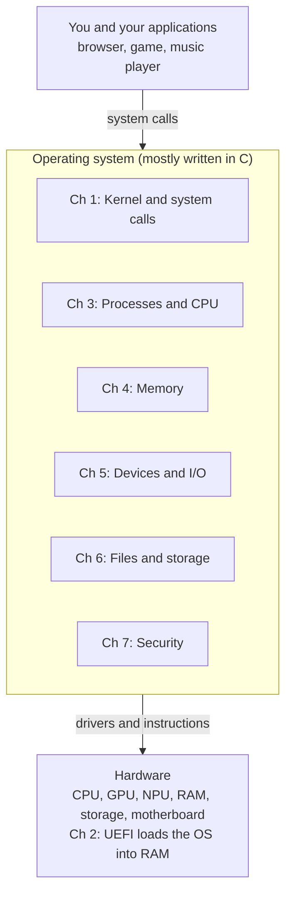

# Operating Systems:

## Module overview

An operating system is the layer where software meets hardware: the CPU, GPU, NPU, RAM and motherboard are all managed by the OS, which is mostly written in C. This guide covers the operating system as one topic that branches into eight chapters, joins them together in one story, and ends with practice questions with checked answers and a reference list.

**Who it is for.** First-year computer science students who know basic computer hardware (CPU, GPU, NPU, motherboard) and have started learning C.

**Before you start.** You should know what a CPU, RAM and a storage drive are, and have seen `#include <stdio.h>` and `printf` in C. 

### Learning outcomes

After working through this guide you should be able to:

1. Explain what an operating system does and how user programs ask the kernel for services through system calls (Chapter 1).
2. Trace the boot process from the power button to the first user process and name the main motherboard parts (Chapter 2).
3. Compare scheduling algorithms and calculate waiting times for FCFS, SJF and Round Robin (Chapter 3).
4. Translate a virtual address, trace page replacement and calculate effective access time (Chapter 4).
5. Compare polling, interrupts and DMA, and explain how drivers connect the OS to the CPU, GPU and NPU (Chapter 5).
6. Describe how files, inodes, directories and permissions work, and compare storage devices (Chapter 6).
7. Distinguish authentication from authorisation and explain the main hardware and software protections (Chapter 7).
8. Read and predict the output of simple C programs that use `printf`, variables and arithmetic (Chapter 8).

### How to use this guide

- Read the chapters in order, because later chapters use ideas from earlier ones (for example, paging uses the kernel and process ideas from Chapters 1 and 3).
- Each chapter follows the same pattern: definition, analogy, how it works, and a worked example where it helps.
- Do the application questions in the Practice chapter after reading, then check your answers.
- Latencies and bandwidths are typical orders of magnitude, not guarantees for any one machine.

## Contents

- [The Big Picture](#the-big-picture)
- [Chapter 1: The Operating System and Its Kernel](#chapter-1-the-operating-system-and-its-kernel)
- [Chapter 2: Starting Up: Boot and the Motherboard](#chapter-2-starting-up-boot-and-the-motherboard)
- [Chapter 3: Running Programs: Processes and the CPU](#chapter-3-running-programs-processes-and-the-cpu)
- [Chapter 4: Memory: Giving Every Program Its Own Space](#chapter-4-memory-giving-every-program-its-own-space)
- [Chapter 5: Devices and I/O: Talking to the Hardware](#chapter-5-devices-and-io-talking-to-the-hardware)
- [Chapter 6: Files and Storage: Keeping Data Organised](#chapter-6-files-and-storage-keeping-data-organised)
- [Chapter 7: Security: Who May Do What](#chapter-7-security-who-may-do-what)
- [Chapter 8: C for Operating Systems: Seeing the Ideas in Code](#chapter-8-c-for-operating-systems-seeing-the-ideas-in-code)
- [Bringing It Together: The Great Invention](#bringing-it-together-the-great-invention)
- [References](#references)

## The Big Picture

Read the picture from top to bottom: applications ask the operating system for help, and the operating system controls the hardware. Chapter 8 shows the C code that operating systems are built from.

| Chapter | The question it answers |
| --- | --- |
| 1. The Operating System and Its Kernel | What is an OS, and how do programs ask it for help? |
| 2. Starting Up: Boot and the Motherboard | What happens between the power button and the desktop? |
| 3. Running Programs: Processes and the CPU | How does one CPU run many programs? |
| 4. Memory: Giving Every Program Its Own Space | Where do programs live while they run? |
| 5. Devices and I/O: Talking to the Hardware | How does the OS use the keyboard, disk, GPU and NPU? |
| 6. Files and Storage: Keeping Data Organised | How are files saved, found and protected? |
| 7. Security: Who May Do What | How does the OS keep users and programs apart? |
| 8. C for Operating Systems: Seeing the Ideas in Code | What does simple C look like behind these ideas? |

## Chapter 1: The Operating System and Its Kernel

**Definition.** An operating system (OS) is system software that manages the hardware resources of a computer and gives programs a common set of services, so each program does not have to talk to the hardware itself.

**Analogy.** Think of a hotel manager. The applications are guests, the hardware is the rooms, electricity and water. The manager decides who gets which room and for how long, and stops one guest from walking into another guest's room.

### 1.1 The layers of a computer system

| **Layer (bottom to top)** | **Examples**                          | **Talks to**                    |
|---------------------------|---------------------------------------|---------------------------------|
| Hardware                  | CPU, RAM, GPU, NPU, SSD, network card | Electrical signals, buses       |
| Firmware and bootloader   | UEFI, GRUB, Windows Boot Manager      | Hardware, then loads the kernel |
| Kernel                    | Linux kernel, Windows NT kernel, XNU  | Hardware through drivers        |
| System libraries          | glibc, Win32 API                      | Kernel through system calls     |
| Shell, GUI and utilities  | bash, File Explorer, desktop          | Libraries and kernel            |
| Applications              | Browser, Word, games                  | Libraries                       |

### 1.2 Kernel mode and user mode

The CPU itself enforces two privilege levels. Code in **kernel mode** (ring 0 on x86) can execute every instruction, touch any memory and talk to any device. Code in **user mode** (ring 3 on x86; EL0 on ARM) cannot change page tables, disable interrupts or access devices directly. A user program cannot execute kernel-mode instructions directly; if it tries, the CPU raises an exception and the OS stops the program. This is why one crashing app does not take down the whole machine.

### 1.3 System calls

A **system call** is the controlled doorway from user mode into the kernel. When a C program calls printf, the library eventually calls write(), which executes a special instruction (syscall on x86-64). The CPU switches to kernel mode and jumps to a fixed kernel entry point. The kernel does the work, then returns to user mode. This is the only way a user program can request a privileged service; it cannot write directly to the disk controller because it runs in user mode and must ask the kernel through a system call, and the kernel checks permissions first.

1. The program calls a library wrapper such as read(), write(), open(), fork() or mmap().

2. The wrapper puts the system call number and arguments in registers and executes syscall.

3. The CPU switches to kernel mode and runs the kernel's system call handler.

4. The kernel checks the arguments and permissions, performs the request and stores the result.

5. The CPU returns to user mode and the program continues.

### 1.4 Kernel designs

| **Design**  | **Idea**                                                                                          | **Examples**            | **Strength**                                  | **Weakness**                              |
|-------------|---------------------------------------------------------------------------------------------------|-------------------------|-----------------------------------------------|-------------------------------------------|
| Monolithic  | Almost all OS services run in kernel space                                                        | Linux                   | Fast, since services call each other directly | A buggy driver can crash the whole system |
| Microkernel | Kernel keeps only scheduling, basic memory and message passing; the rest run as user-mode servers | MINIX 3, QNX, seL4      | More stable and secure, smaller trusted core  | Message passing adds overhead             |
| Hybrid      | Microkernel structure with many services kept in kernel space for speed                           | Windows NT, macOS (XNU) | Balance of speed and structure                | More complex                              |

In a **microkernel**, most services run as user-mode servers.

### 1.5 Hardware abstraction

Drivers and the hardware abstraction layer hide differences between devices. A program that writes to a file does not care whether the disk is a hard drive, a SATA SSD or an NVMe SSD, and a game calling a graphics API does not care which GPU model is installed.

### 1.6 System software and developer tools

System software includes the OS, utilities and compilers. The tools below run on top of the OS and are used to build and maintain programs.

| **Tool**              | **What it does**                                                                         |
|-----------------------|------------------------------------------------------------------------------------------|
| Compiler              | Translates the whole source code into machine code before the program runs (C, C++)      |
| Interpreter           | Executes source code line by line while it runs (Python, JavaScript)                     |
| Linker                | Combines compiled files and libraries into one executable                                |
| Debugger              | Pauses a program at breakpoints so you can inspect variables and find errors (GDB for C) |
| IDE                   | One application with a code editor, build tools and a debugger                           |
| Version control (Git) | Tracks changes to source code, restores earlier versions and lets a team collaborate     |
| Unit tests            | Check one small component in isolation, so regressions are caught early                  |

A compiler translates all the code into machine code first; an interpreter runs line by line and is usually easier to debug. A web browser such as Chrome is application software, not system software, because it serves the user instead of managing hardware. Middleware, on the other hand, acts as a bridge between applications and systems so different programs can communicate — think of databases, APIs and connectors.

## Visual References

*Figure 1.1. Overview of the layers from hardware to applications. Source: [computerbasics](https://computerbasicsforluddites.wordpress.com/wp-content/uploads/2013/10/computer-layers.jpg?w=1090).*

*Figure 1.2. Visual flowchart of one system call and the kernel. Source: [thecodinggopher](https://substackcdn.com/image/fetch/$s_!lULe!,f_auto,q_auto:good,fl_progressive:steep/https%3A%2F%2Fsubstack-post-media.s3.amazonaws.com%2Fpublic%2Fimages%2Faced0ed6-0246-408a-93a8-3e35524c4d64_1400x876.jpeg).*

*Figure 1.3. Visual flowchart of software tools. Source: [geeksforgeeks](https://media.geeksforgeeks.org/wp-content/uploads/20260606161812658058/2056958231.webp).*