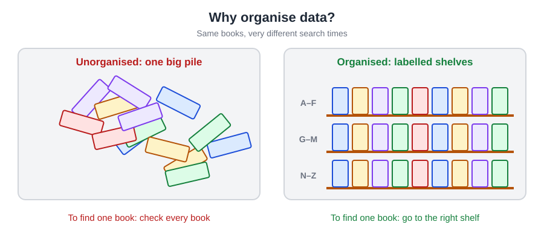
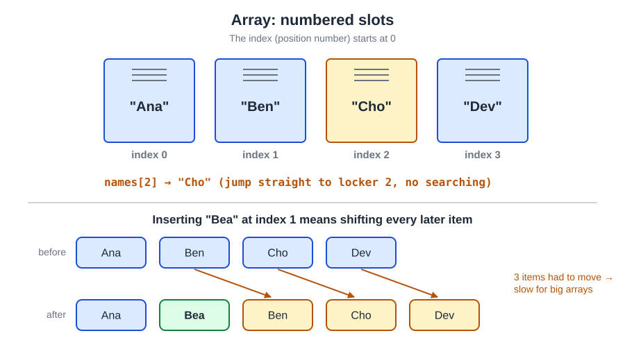
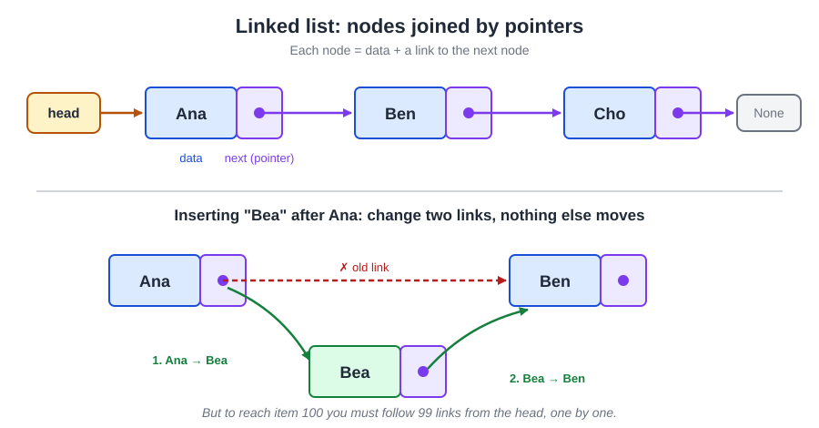
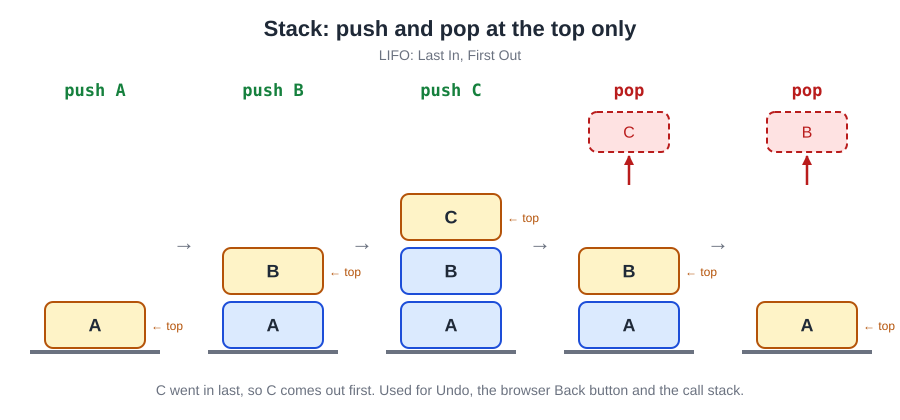
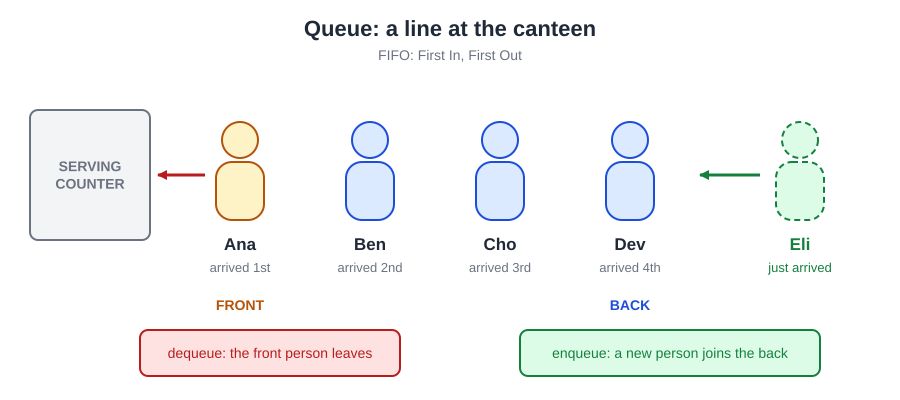
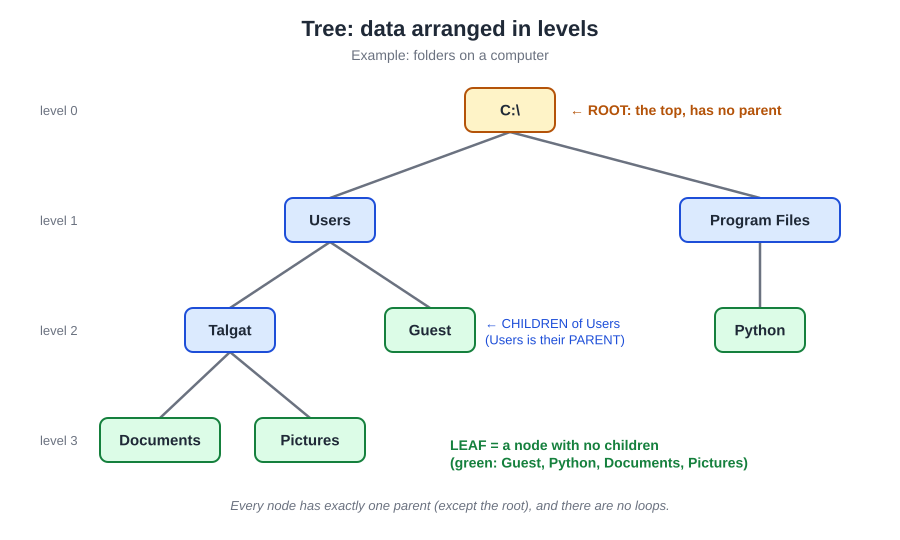
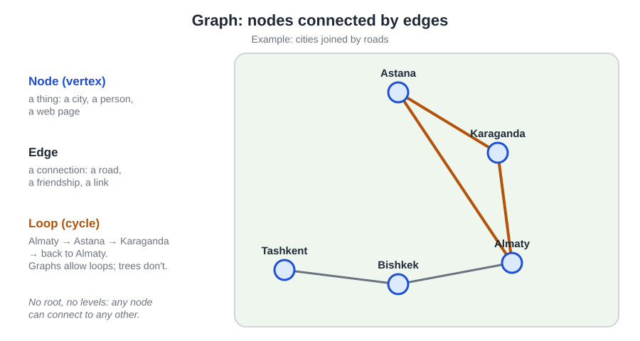
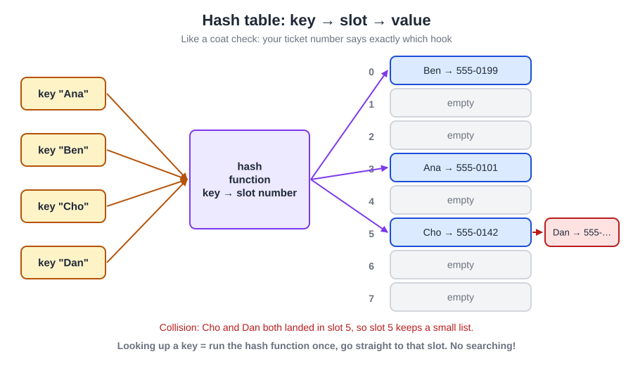
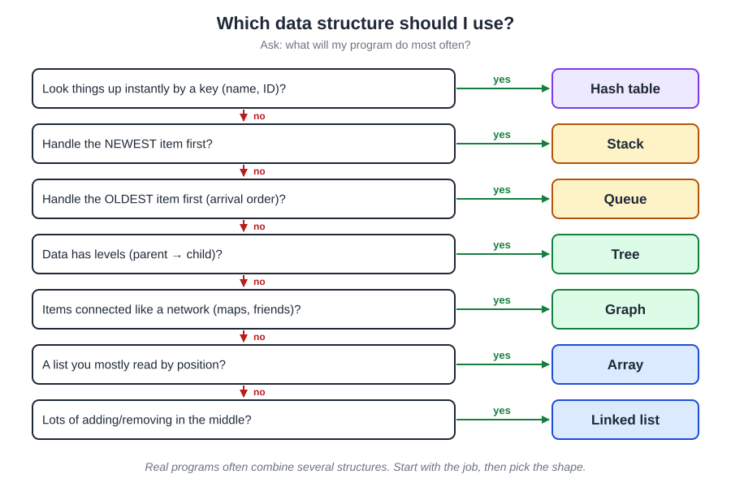
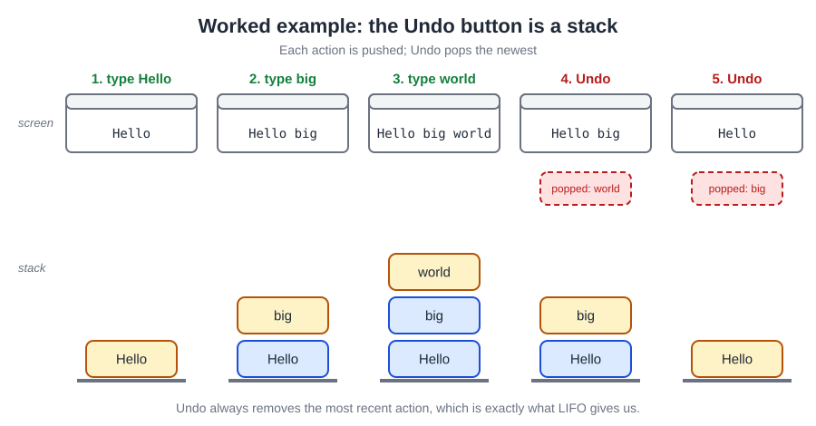

# Part 13 — Diagrams and Pictures

All diagrams are SVG files, so they stay sharp at any size. To use one in Canva, open it on GitHub, right-click it and save it, or take a screenshot.

| File | What it shows | Used in Main Theory |
|---|---|---|
| `13-01-why-organise-data.svg` | A messy pile of books vs labelled shelves | §1 |
| `13-02-array-lockers.svg` | Array as numbered lockers; inserting shifts later items | §2 |
| `13-03-linked-list.svg` | Nodes and pointers; inserting by changing two links | §3 |
| `13-04-stack-push-pop.svg` | A stack after push A, B, C, then two pops | §4 |
| `13-05-queue-line.svg` | A queue as people at a canteen counter | §5 |
| `stack-vs-queue.svg` | Stack (LIFO) next to queue (FIFO) | §5 |
| `13-06-tree-anatomy.svg` | Folder tree with root, parent, children and leaves labelled | §6 |
| `13-07-graph-map.svg` | Cities and roads as nodes and edges, with a loop | §7 |
| `13-08-hash-table.svg` | Keys → hash function → slots, with a collision | §8 |
| `13-09-choose-a-structure.svg` | Yes/no chart for choosing a structure | §9 |
| `13-10-undo-worked-example.svg` | Screen and undo stack at each step of the worked example | §10 |

## Preview

