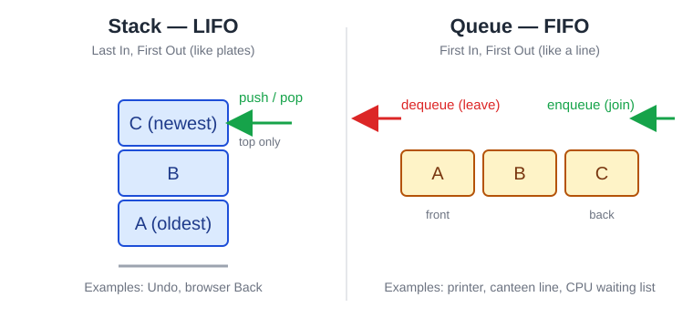

# Part 13 — Diagrams and Pictures

| File | What it shows | Use in |
|---|---|---|
| `stack-vs-queue.svg` | Stack (LIFO) next to queue (FIFO), with push/pop and enqueue/dequeue arrows | Main Theory §4–5, slides, study guide |

The Main Theory file also contains **Mermaid diagrams** that GitHub draws automatically: a linked list (§3), a queue (§5), a folder tree (§6), a city graph (§7) and a hash table (§8). To reuse one in Canva, open the Main Theory page on GitHub and take a screenshot of the drawn diagram.
