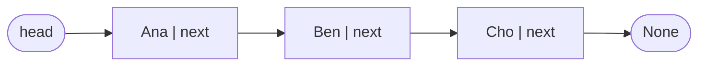
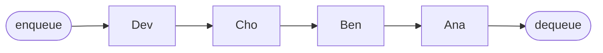
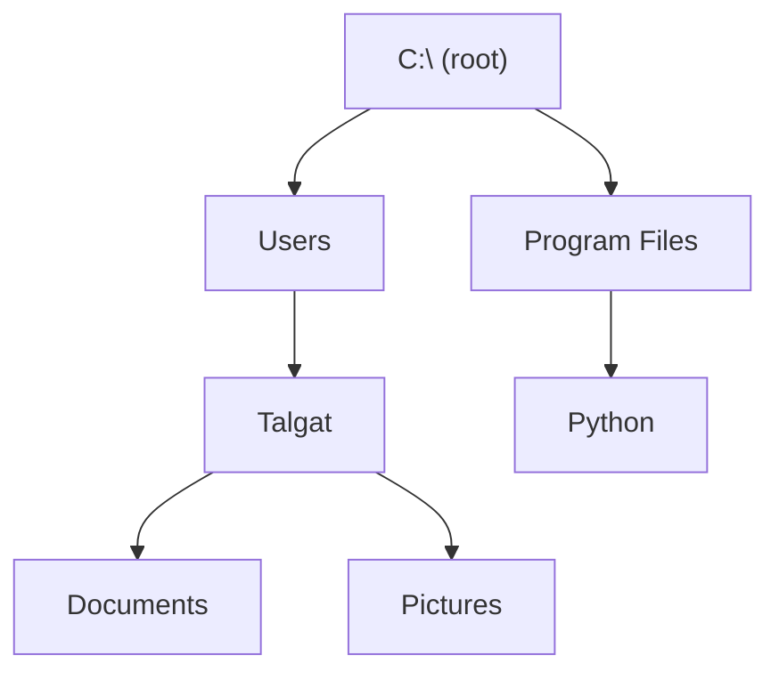
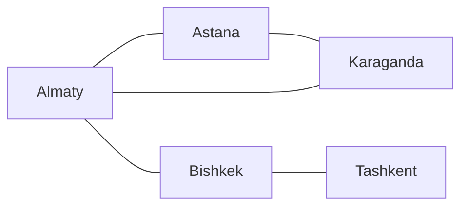
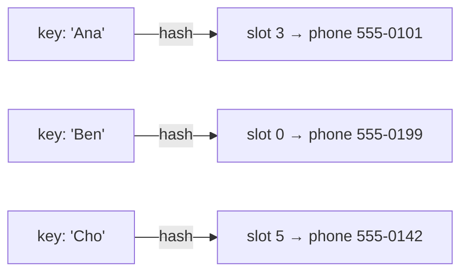

# Part 13 — Data Structures

> **In one sentence:** a data structure is a way of organising information inside a program so that the jobs you need to do with it are easy and fast.

**You will be able to:**

1. Explain what a data structure is, using everyday examples.
2. Describe six common structures: array, linked list, stack, queue, tree, graph, and hash table.
3. Choose a suitable structure for a simple real-world problem.
4. Trace what happens to a stack and a queue step by step.

**Before you start:** you only need to know that a program stores values in *variables* (Part 11). No other programming knowledge is assumed.

---

## 1. Why do we need data structures?

Imagine a library that throws every book into one big pile. All the books are *there*, but finding one takes forever. A real library sorts books onto shelves, by topic and author, so a librarian can find any book quickly.

Programs have the same problem. They store **data** (names, scores, messages, map locations…) and the way that data is arranged decides how quickly the program can:

- **find** an item (search),
- **add** an item (insert),
- **remove** an item (delete),
- **visit every item** (traverse), or
- **put items in order** (sort).

| Key term | Meaning |
|---|---|
| **Data** | Facts or values a program works with, e.g. `42`, `"Talgat"`. |
| **Data structure** | A way of arranging data in memory so certain operations are easy. |
| **Element / item** | One piece of data stored in the structure. |
| **Operation** | Something we do to the structure: insert, delete, search, traverse, sort. |

> 💡 **Big idea:** no data structure is best at everything. Each one makes some jobs fast and other jobs slow. Choosing a structure means asking *"What will my program do most often?"*

---

## 2. Array — numbered lockers

An **array** stores items side by side in numbered positions. The position number is called the **index**, and in most languages (including Python and C) it **starts at 0**.

```
 index:    0        1        2        3
        +--------+--------+--------+--------+
        | "Ana"  | "Ben"  | "Cho"  | "Dev"  |
        +--------+--------+--------+--------+
```

**Analogy:** a row of numbered school lockers. If you know the locker number, you walk straight to it.

- ✅ **Fast:** getting an item when you know its index (`names[2]` → `"Cho"`).
- ❌ **Slow:** inserting in the middle. To put `"Bea"` at index 1, `"Ben"`, `"Cho"` and `"Dev"` must each shift one place to the right.

```python
names = ["Ana", "Ben", "Cho", "Dev"]   # Python's list works like an array
print(names[2])        # Cho  -> jump straight to index 2
names.insert(1, "Bea") # every later item shifts right
print(names)           # ['Ana', 'Bea', 'Ben', 'Cho', 'Dev']
```

---

## 3. Linked list — a treasure hunt

A **linked list** stores each item in a **node**. A node holds two things: the data, and a **pointer** (a link) to the next node. The last node points to nothing (`None` / `NULL`).



**Analogy:** a treasure hunt. Each clue tells you where the next clue is. To reach clue 5 you must follow clues 1, 2, 3 and 4 first.

- ✅ **Fast:** inserting or removing once you are at the right spot — just change one or two links, nothing shifts.
- ❌ **Slow:** reaching item number *n* — you must follow the links one by one from the start.

| Key term | Meaning |
|---|---|
| **Node** | One box in a linked list: data + link to the next node. |
| **Pointer / link** | A value that says *where* another piece of data is in memory. |
| **Head** | The first node; the starting point of the list. |

---

## 4. Stack — a pile of plates (LIFO)

A **stack** only lets you add or remove at **one end**, called the **top**.

- **push** = put an item on top
- **pop** = take the top item off

This rule is called **LIFO — Last In, First Out**: the last plate you put on the pile is the first one you take off.

```
 push A      push B      push C       pop → C      pop → B
                         +-----+
             +-----+     |  C  | top   +-----+
 +-----+     |  B  |     |  B  |       |  B  | top  +-----+
 |  A  |     |  A  |     |  A  |       |  A  |      |  A  | top
 +-----+     +-----+     +-----+       +-----+      +-----+
```

**Where you meet stacks:** the **Undo** button (the most recent action is undone first), the **Back** button in a web browser, and the way a computer keeps track of function calls (the *call stack*, see Part 8).

```python
stack = []
stack.append("A")   # push
stack.append("B")   # push
stack.append("C")   # push
print(stack.pop())  # C  (last in, first out)
print(stack.pop())  # B
print(stack)        # ['A']
```

---

## 5. Queue — a line at the canteen (FIFO)

A **queue** adds items at the **back** and removes them from the **front**.

- **enqueue** = join the back of the line
- **dequeue** = leave from the front of the line

This rule is called **FIFO — First In, First Out**: whoever arrived first is served first.



*Ana arrived first, so Ana is served first. Dev just joined the back.*

**Where you meet queues:** a printer printing documents in the order they were sent, customer-support chats, and the operating system lining up programs waiting for the CPU (Part 3).

```python
from collections import deque   # a ready-made queue in Python
line = deque()
line.append("Ana")      # enqueue
line.append("Ben")
line.append("Cho")
print(line.popleft())   # Ana  (first in, first out)
print(list(line))       # ['Ben', 'Cho']
```

> ⚠️ **Common mix-up:** stack = *plates* = newest first. Queue = *line of people* = oldest first.

---

## 6. Tree — a family tree or folder system

A **tree** stores data in a **hierarchy** (levels). It starts at one **root** node, and each node can have **children** below it. A node with no children is a **leaf**.



**Where you meet trees:** folders on your computer, a company organisation chart, the structure of a web page (HTML), and decision trees in symbolic AI (Part 18).

| Key term | Meaning |
|---|---|
| **Root** | The top node, with no parent. |
| **Parent / child** | A node directly above / below another node. |
| **Leaf** | A node with no children. |
| **Binary tree** | A tree where every node has at most two children. |

---

## 7. Graph — a map of connections

A **graph** is a set of **nodes** (also called *vertices*) joined by **edges**. Unlike a tree, there is no single top, and connections can form loops.



**Where you meet graphs:** road maps and GPS route finding, social networks (people = nodes, friendships = edges), and "customers who bought this also bought…" recommendations. Searching a graph with breadth-first or depth-first search is a core idea in Part 19.

```python
# A graph stored as "each city -> list of neighbours"
roads = {
    "Almaty":    ["Astana", "Bishkek", "Karaganda"],
    "Astana":    ["Almaty", "Karaganda"],
    "Bishkek":   ["Almaty", "Tashkent"],
    "Karaganda": ["Astana", "Almaty"],
    "Tashkent":  ["Bishkek"],
}
print(roads["Bishkek"])   # ['Almaty', 'Tashkent']
```

---

## 8. Hash table — a dictionary with instant lookup

A **hash table** stores **key → value** pairs, like a word and its meaning in a dictionary. A **hash function** turns the key into a slot number, so the program jumps straight to the right place instead of searching.



**Analogy:** a coat check. You hand over your coat and get ticket number 17. Later you give ticket 17 and the attendant goes straight to hook 17 — no searching through every coat.

- ✅ **Fast:** looking up a value by its key — on average almost the same speed no matter how many items there are.
- ❌ **Not ordered:** a hash table is not designed to keep items sorted.
- ⚠️ **Collision:** two keys can hash to the same slot. Real hash tables handle this automatically (for example by storing a small list in that slot).

```python
phone = {"Ana": "555-0101", "Ben": "555-0199"}   # Python's dict is a hash table
phone["Cho"] = "555-0142"   # insert
print(phone["Ben"])         # 555-0199 -> found instantly by key
```

---

## 9. Comparing the structures

| Structure | Rule / shape | Good at | Weak at | Everyday example |
|---|---|---|---|---|
| **Array** | Numbered slots | Get item by index | Insert/delete in the middle | Lockers |
| **Linked list** | Chain of nodes | Insert/delete once at the spot | Jump to item *n* | Treasure hunt |
| **Stack** | LIFO, one end | Newest-first jobs | Reaching old items | Plates, Undo |
| **Queue** | FIFO, two ends | Fair, arrival-order jobs | Reaching the middle | Canteen line, printer |
| **Tree** | Hierarchy | Levels, parent/child | Many-to-many links | Folders |
| **Graph** | Nodes + edges | Networks, routes | Simple ordering | Maps, social networks |
| **Hash table** | Key → value | Lookup by key | Keeping things sorted | Phone book, coat check |

> 🔗 Part 12 (Algorithms) explains how to measure "fast" and "slow" more precisely with **Big-O notation**. For example, an array index lookup is O(1) (constant time), while finding item *n* in a linked list is O(n), because the work grows with the list.

---

## 10. Worked example — building an Undo button

**Problem:** a simple text editor must let the user undo their most recent actions. Which data structure should we use?

**Step 1 — What does the program do most often?**
It records each new action, and *Undo* always reverses the **most recent** one.

**Step 2 — Match to a rule.** "Most recent first" = **LIFO** → a **stack**.

**Step 3 — Trace it.** The user types three words, then presses Undo twice.

| Step | Action | Stack after (bottom → top) | Text on screen |
|---|---|---|---|
| 1 | type "Hello" → push | `[Hello]` | Hello |
| 2 | type "big" → push | `[Hello, big]` | Hello big |
| 3 | type "world" → push | `[Hello, big, world]` | Hello big world |
| 4 | Undo → pop "world" | `[Hello, big]` | Hello big |
| 5 | Undo → pop "big" | `[Hello]` | Hello |

**Step 4 — Check with code.**

```python
undo_stack = []
for word in ["Hello", "big", "world"]:
    undo_stack.append(word)            # each action is pushed
print("Undo removes:", undo_stack.pop())   # world
print("Undo removes:", undo_stack.pop())   # big
print("Left:", undo_stack)                 # ['Hello']
```

**Why not a queue?** A queue would undo "Hello" first — the *oldest* action — which is not what users expect.

---

## 11. Bonus for curious learners — where the data lives in memory

In C (Part 8), memory for a data structure can be reserved in two main ways:

- **Static / fixed size:** the size is known before the program runs, e.g. `int scores[10];`.
- **Dynamic:** memory is requested while the program runs with `malloc()` and must be given back with `free()`. Linked lists, trees and graphs usually grow this way, one node at a time. Dynamic memory commonly comes from the **heap**.

Do not confuse the *stack data structure* in this part with *the stack* in memory, which is the area where a running program keeps function calls and local variables. They share a name because both work LIFO.

---

## 12. Summary

- A data structure organises data so that common operations are efficient.
- **Array** = numbered slots; **linked list** = chain of nodes.
- **Stack** = LIFO (plates, Undo); **queue** = FIFO (line, printer).
- **Tree** = hierarchy (folders); **graph** = network (maps).
- **Hash table** = key → value with very fast lookup.
- Choose a structure by asking what the program does *most often*.

➡️ Practise in [Learner Activity](../Learner%20Activity/13_learner-activity.md). Sources are in [References and AI Usage](../References%20and%20AI%20Usage/13_references-and-ai-usage.md).
