# Part 14 — Diagrams and Pictures

All diagrams are SVG files, so they stay sharp at any size. To use one in Canva, open it on GitHub, right-click it and save it, or take a screenshot.

| File | What it shows | Used in Main Theory |
|---|---|---|
| `14-01-file-vs-database.svg` | Many people sharing one file vs going through a DBMS | §1 |
| `14-02-how-a-query-travels.svg` | App → SQL query → DBMS → stored data → result | §1 |
| `14-03-table-anatomy.svg` | Table, row, column, cell and primary key labelled | §2 |
| `tables-and-keys.svg` | Foreign keys in Enrolments pointing to Students and Courses | §3 |
| `14-04-relationship-types.svg` | One-to-one, one-to-many, many-to-many | §3 |
| `14-06-crud.svg` | Create / Read / Update / Delete with SQL examples | §4 |
| `14-05-select-anatomy.svg` | What each line of a SELECT query does | §4 |
| `14-07-join-step-by-step.svg` | How a JOIN matches rows across three tables | §5 |
| `14-08-normalisation.svg` | A table with repeated data split into three linked tables | §6 |
| `14-09-transaction-commit-rollback.svg` | Bank transfer: COMMIT vs crash + ROLLBACK | §7 |
| `14-10-acid.svg` | The four ACID properties with everyday comparisons | §7 |
| `14-11-index.svg` | Textbook index vs database index | §8 |
| `14-12-sql-vs-nosql.svg` | Table vs document vs key–value vs graph | §9 |

## Preview

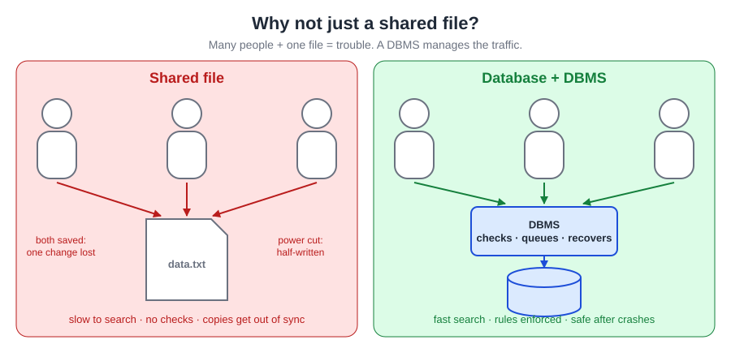
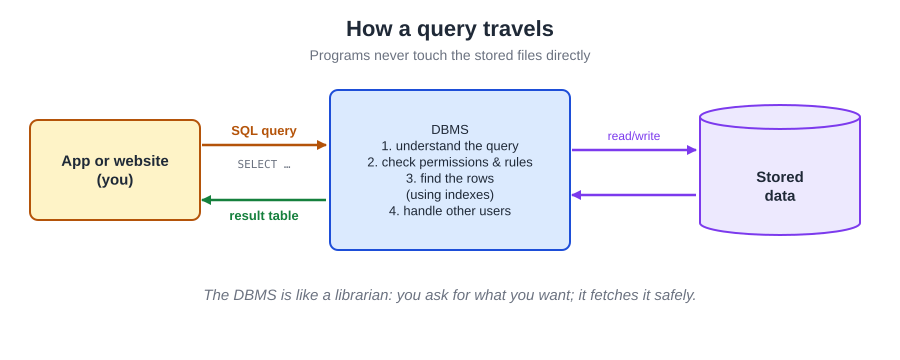
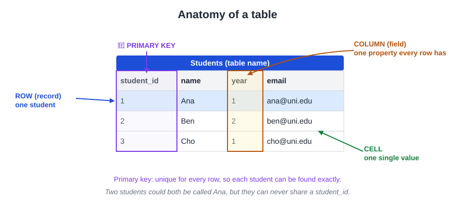
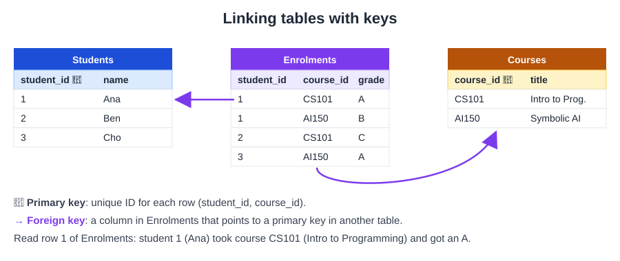
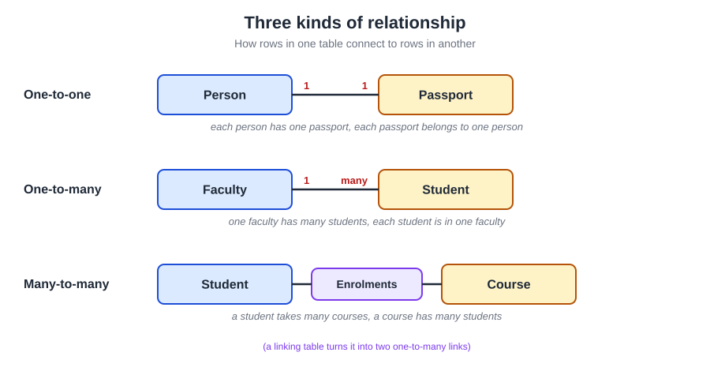
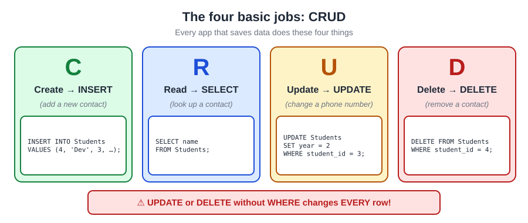
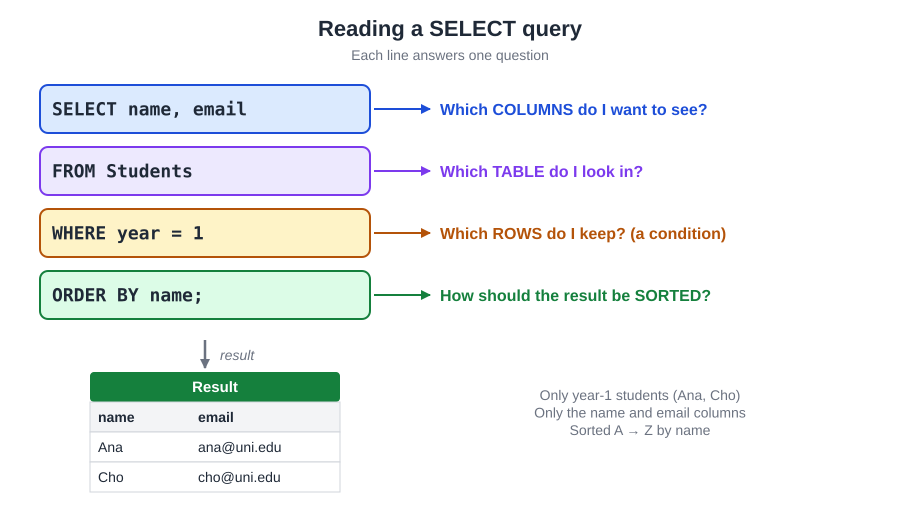
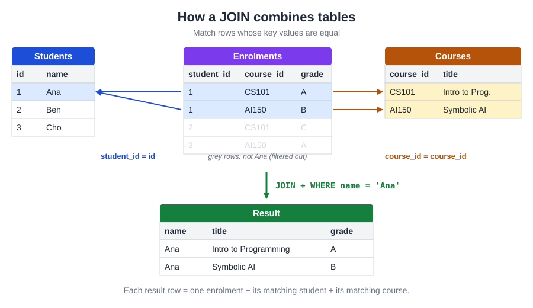
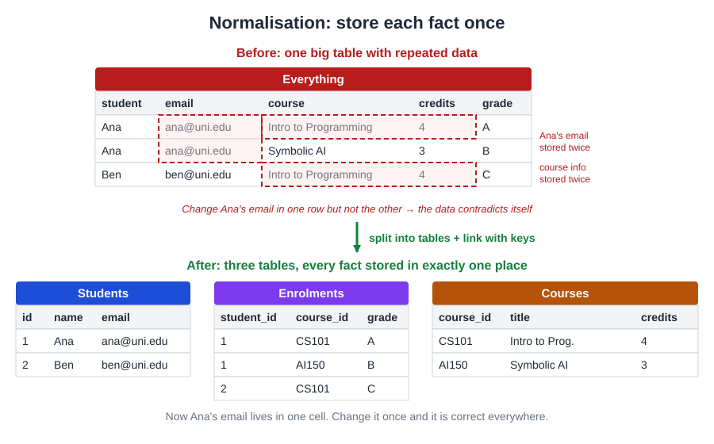
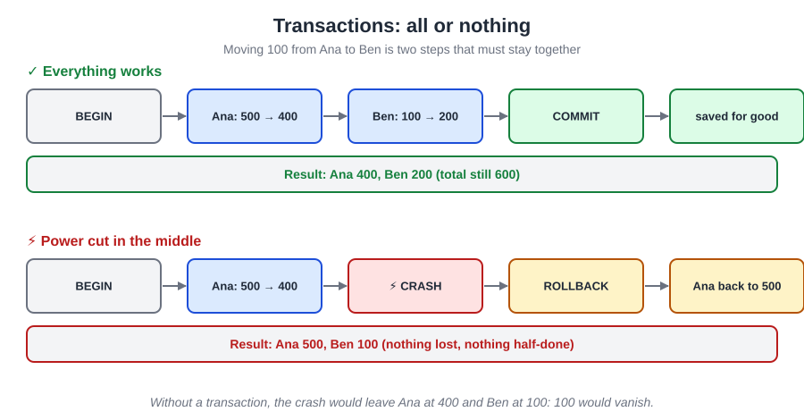
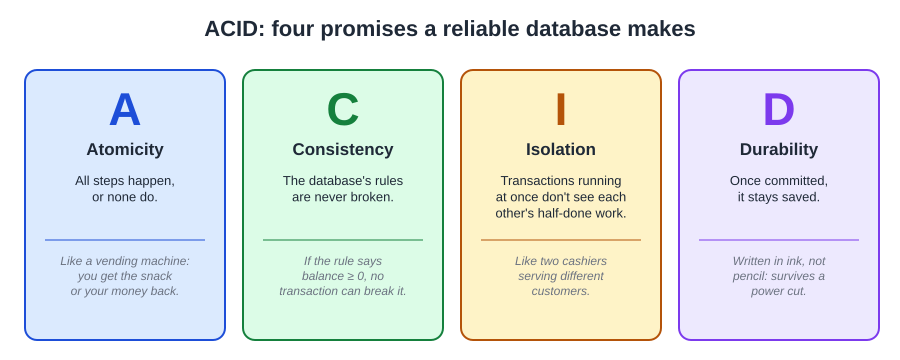
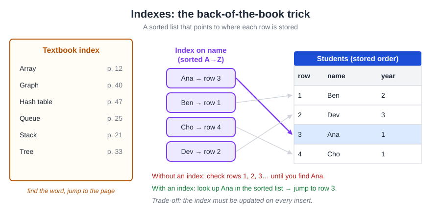
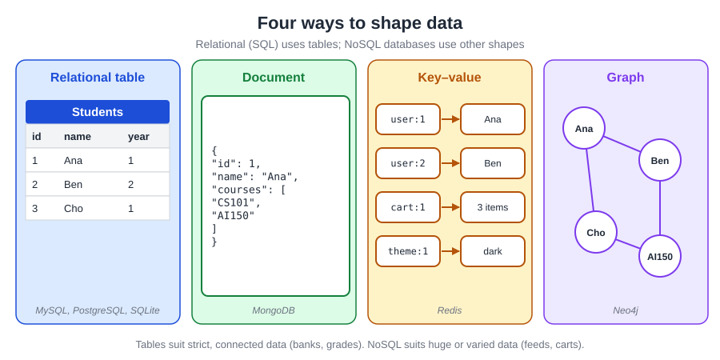
