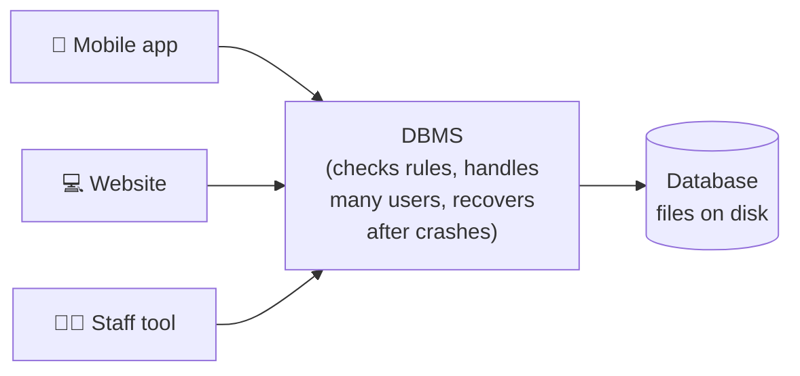
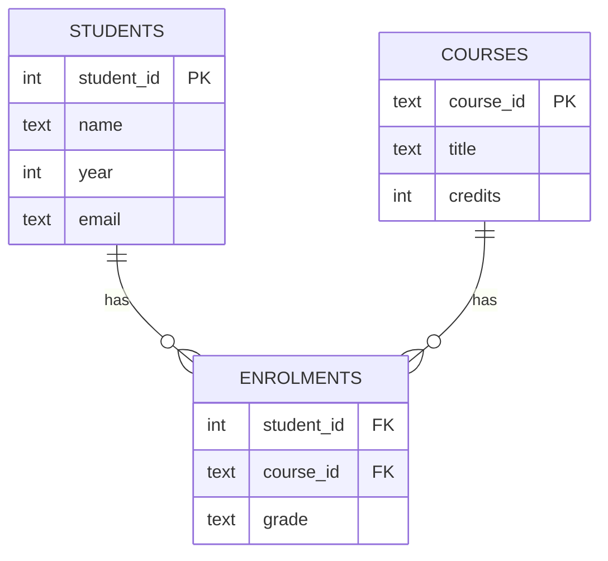

# Part 14 — Databases

> **In one sentence:** a database is an organised, long-lasting collection of data that many people and programs can store, search and update safely at the same time.

**You will be able to:**

1. Explain what a database and a DBMS are, and why we use them instead of plain files.
2. Describe tables, rows, columns, primary keys and foreign keys.
3. Read and write simple SQL queries (`SELECT`, `WHERE`, `ORDER BY`, `INSERT`, `JOIN`).
4. Explain why we avoid repeating data, and what a transaction is.
5. Compare relational (SQL) and NoSQL databases at a basic level.

**Before you start:** Part 13 showed how a program organises data *while it is running*. A database keeps data organised **after the program closes**, and shares it between many users.

---

## 1. What is a database, and why not just use a file?

Think of every app you use: Instagram remembers your posts, a bank remembers your balance, your university remembers your grades. That information must survive when the app is closed, and thousands of people may be reading and changing it at once.

You *could* store it in a text file or a spreadsheet. That works for a few people, but it quickly causes problems:

| Problem with a plain file | What goes wrong |
|---|---|
| **Searching is slow** | Finding one student among 1,000,000 lines means reading line by line. |
| **Two people edit at once** | One person's change overwrites the other's. |
| **Mistakes slip in** | Someone types a grade as `"A+++"` or leaves the ID empty. |
| **Repeated data** | A student's email is copied into 10 places; one gets updated, 9 don't. |
| **Crashes** | Power cuts mid-save can leave the file half-written. |

A database, managed by a DBMS, is designed to solve all of these.

| Key term | Meaning |
|---|---|
| **Database** | An organised collection of stored data. |
| **DBMS** (Database Management System) | The software that stores the data and lets people query it safely, e.g. MySQL, PostgreSQL, SQLite, Oracle, MongoDB. |
| **Query** | A question or instruction sent to the database, e.g. "show all students in year 1". |
| **SQL** (Structured Query Language, said "S-Q-L" or "sequel") | The standard language for talking to relational databases. |



*Users and programs never touch the stored files directly; they send queries to the DBMS.*

---

## 2. The relational model — data in tables

Most databases today are **relational databases**. The idea (from Edgar F. Codd, 1970) is simple: store data in **tables**, like a set of neat spreadsheets that are linked together.

**Table `Students`**

| student_id | name | year | email |
|---|---|---|---|
| 1 | Ana | 1 | ana@uni.edu |
| 2 | Ben | 2 | ben@uni.edu |
| 3 | Cho | 1 | cho@uni.edu |

| Key term | Meaning | In the table above |
|---|---|---|
| **Table** (relation) | A collection of data about one kind of thing. | `Students` |
| **Row** (record) | One item / one thing. | Ana's row |
| **Column** (field / attribute) | One property every row has. | `year` |
| **Data type** | What kind of value a column holds: whole number, text, date… | `year` is a number |
| **Primary key** | A column whose value is **unique** for every row, so each row can be identified. | `student_id` |

> 💡 **Why not use `name` as the primary key?** Two students can share a name. An ID number is guaranteed to be unique, just like your student card number.

---

## 3. Linking tables — foreign keys and relationships

A university also tracks **courses** and which students are **enrolled** in them. Instead of cramming everything into one giant table, we use three tables and link them.

**Table `Courses`**

| course_id | title | credits |
|---|---|---|
| CS101 | Intro to Programming | 4 |
| AI150 | Symbolic AI | 3 |

**Table `Enrolments`**

| student_id | course_id | grade |
|---|---|---|
| 1 | CS101 | A |
| 1 | AI150 | B |
| 2 | CS101 | C |
| 3 | AI150 | A |

In `Enrolments`, `student_id` points to a row in `Students`, and `course_id` points to a row in `Courses`. A column that refers to another table's primary key is called a **foreign key**.



*How to read the diagram: one student can have **many** enrolments, and one course can have **many** enrolments. This is called a **one-to-many** relationship. Together, the enrolments describe a **many-to-many** relationship between students and courses.*

| Key term | Meaning |
|---|---|
| **Foreign key** | A column that stores another table's primary key, creating a link. |
| **Relationship** | How rows in two tables are connected: one-to-one, one-to-many, many-to-many. |
| **ER diagram** (Entity–Relationship) | A picture of the tables and how they link, like the one above. |

---

## 4. Talking to the database with SQL

SQL reads almost like English. The four most common jobs are often remembered as **CRUD**: **C**reate, **R**ead, **U**pdate, **D**elete.

| Job | SQL keyword | Example |
|---|---|---|
| Create a table | `CREATE TABLE` | `CREATE TABLE Students (student_id INTEGER PRIMARY KEY, name TEXT, year INTEGER, email TEXT);` |
| Add a row | `INSERT` | `INSERT INTO Students VALUES (4, 'Dev', 3, 'dev@uni.edu');` |
| Read rows | `SELECT` | `SELECT name FROM Students;` |
| Change rows | `UPDATE` | `UPDATE Students SET year = 2 WHERE student_id = 3;` |
| Remove rows | `DELETE` | `DELETE FROM Students WHERE student_id = 4;` |

> ⚠️ **Always use `WHERE` with `UPDATE` and `DELETE`.** `DELETE FROM Students;` with no `WHERE` deletes **every** student.

### Reading data with `SELECT`

```sql
SELECT name, email        -- which columns to show
FROM Students             -- which table
WHERE year = 1            -- which rows (a condition)
ORDER BY name;            -- sort the result
```

Result:

| name | email |
|---|---|
| Ana | ana@uni.edu |
| Cho | cho@uni.edu |

Useful extras:

- `SELECT * FROM Students;` — `*` means "all columns".
- `WHERE year >= 2 AND name <> 'Ben'` — combine conditions with `AND`, `OR`, `NOT` (the same logic you will use for rules in Part 17).
- `SELECT COUNT(*) FROM Students;` — count rows. Others: `AVG`, `SUM`, `MIN`, `MAX`.

---

## 5. Worked example — "Which courses is Ana taking, and what grades did she get?"

The answer is spread over **three** tables. We combine them with a **JOIN**, which matches rows whose keys are equal.

**Step 1 — Start from the table that links everything:** `Enrolments`.

**Step 2 — Join `Students`** so we can see names instead of ID numbers. Match rows where `Enrolments.student_id = Students.student_id`.

**Step 3 — Join `Courses`** so we can see course titles. Match rows where `Enrolments.course_id = Courses.course_id`.

**Step 4 — Keep only Ana's rows** with `WHERE`.

```sql
SELECT Students.name, Courses.title, Enrolments.grade
FROM Enrolments
JOIN Students ON Enrolments.student_id = Students.student_id
JOIN Courses  ON Enrolments.course_id  = Courses.course_id
WHERE Students.name = 'Ana';
```

**Step 5 — What the database does, visually:**

```
Enrolments row          + matching Students row  + matching Courses row         → result row
(1, CS101, A)           + (1, Ana, 1, ...)       + (CS101, Intro to Prog., 4)   → Ana | Intro to Programming | A
(1, AI150, B)           + (1, Ana, 1, ...)       + (AI150, Symbolic AI, 3)      → Ana | Symbolic AI          | B
(2, CS101, C)           + (2, Ben, ...)          → removed by WHERE (not Ana)
(3, AI150, A)           + (3, Cho, ...)          → removed by WHERE (not Ana)
```

Result:

| name | title | grade |
|---|---|---|
| Ana | Intro to Programming | A |
| Ana | Symbolic AI | B |

**Try it yourself:** every SQL example in this part can be run for free in Python's built-in `sqlite3` module, or pasted into an online SQLite playground. The full script is in the [Learner Activity](../Learner%20Activity/14_learner-activity.md).

---

## 6. Good design — don't repeat yourself (normalisation)

Why did we use three tables instead of one big one? Look at this badly designed single table:

| student_name | email | course_title | credits | grade |
|---|---|---|---|---|
| Ana | ana@uni.edu | Intro to Programming | 4 | A |
| Ana | ana@uni.edu | Symbolic AI | 3 | B |
| Ben | ben@uni.edu | Intro to Programming | 4 | C |

Ana's email is stored **twice**, and "Intro to Programming, 4 credits" is stored **twice**. This causes **anomalies** (errors):

- **Update anomaly:** Ana changes her email; we update one row but forget the other. Now the database disagrees with itself.
- **Delete anomaly:** if Ben drops his only course and we delete his row, we lose the fact that Ben exists at all.
- **Insert anomaly:** we cannot add a new course until some student enrols in it.

**Normalisation** is the process of splitting data into separate tables so **each fact is stored in exactly one place**, then linking them with keys. That is exactly what `Students`, `Courses` and `Enrolments` do.

---

## 7. Keeping data safe — transactions and ACID

Imagine transferring 100 from Ana's bank account to Ben's. That is **two** steps:

1. Subtract 100 from Ana.
2. Add 100 to Ben.

If the power cuts after step 1, 100 simply vanishes. A **transaction** groups steps so they happen **all together or not at all**.

```sql
BEGIN TRANSACTION;
UPDATE Accounts SET balance = balance - 100 WHERE owner = 'Ana';
UPDATE Accounts SET balance = balance + 100 WHERE owner = 'Ben';
COMMIT;      -- make both changes permanent
-- if anything fails before COMMIT, the DBMS does a ROLLBACK (undoes everything)
```

Reliable databases promise four properties, remembered as **ACID**:

| Letter | Property | Plain meaning |
|---|---|---|
| **A** | Atomicity | All steps happen, or none do. |
| **C** | Consistency | Rules are never broken (e.g. a balance can't be text). |
| **I** | Isolation | Two transactions at the same time don't mess each other up. |
| **D** | Durability | Once committed, the change survives a crash or power cut. |

---

## 8. Making searches fast — indexes

Finding Ana among a million students by checking every row is slow. An **index** is an extra, sorted structure that the DBMS keeps on a column, like the index at the back of a textbook, so it can jump straight to the right rows. Indexes are often built with trees (B-trees) or hash tables, which you met in Part 13.

Trade-off: an index makes **searching** faster but makes **inserting and updating** slightly slower, and uses extra storage, because the index must be kept up to date too.

---

## 9. Relational (SQL) vs NoSQL

Not all data fits neatly into tables. **NoSQL** ("not only SQL") databases store data in other shapes.

| | Relational (SQL) | NoSQL |
|---|---|---|
| **Shape of data** | Tables with fixed columns | Documents (JSON-like), key–value pairs, graphs, wide columns |
| **Structure** | Strict; defined up front (the *schema*) | Flexible; items can have different fields |
| **Good for** | Banking, grades, orders — data with clear relationships and strict correctness | Huge, fast-changing or varied data: social media feeds, sensor data, shopping carts |
| **Examples** | MySQL, PostgreSQL, SQLite, Oracle | MongoDB (documents), Redis (key–value), Neo4j (graph) |

A NoSQL **document** for Ana might look like this:

```json
{
  "student_id": 1,
  "name": "Ana",
  "year": 1,
  "courses": [
    {"title": "Intro to Programming", "grade": "A"},
    {"title": "Symbolic AI", "grade": "B"}
  ]
}
```

Neither is "better". The choice depends on the data and what the application needs, just like choosing a data structure in Part 13.

---

## 10. Link to Symbolic AI

A symbolic AI system stores **knowledge as facts and rules** (Parts 16–18). A table of facts is very close to a database table:

| Database row | Same fact in logic |
|---|---|
| `Enrolments(1, 'CS101', 'A')` | `enrolled(ana, cs101).` |

An expert system's *knowledge base* is often kept in a database, and a rule such as *IF a student has grade A in CS101 THEN they may take CS201* works like a SQL query with a `WHERE` condition.

---

## 11. Summary

- A **database** stores data permanently and safely; a **DBMS** is the software that manages it.
- Relational databases use **tables** of **rows** and **columns**.
- A **primary key** uniquely identifies a row; a **foreign key** links to another table.
- **SQL** reads and changes data: `SELECT … FROM … WHERE … ORDER BY`, `INSERT`, `UPDATE`, `DELETE`, `JOIN`.
- **Normalisation** stores each fact once, to avoid anomalies.
- **Transactions** and **ACID** keep data correct even during crashes.
- **Indexes** speed up searches; **NoSQL** handles data that doesn't fit tables.

➡️ Practise in [Learner Activity](../Learner%20Activity/14_learner-activity.md). Sources are in [References and AI Usage](../References%20and%20AI%20Usage/14_references-and-ai-usage.md).
