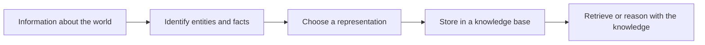
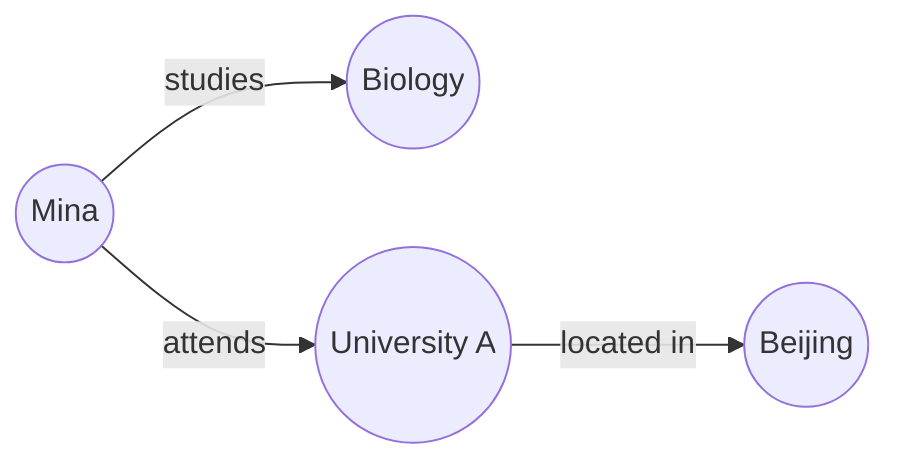
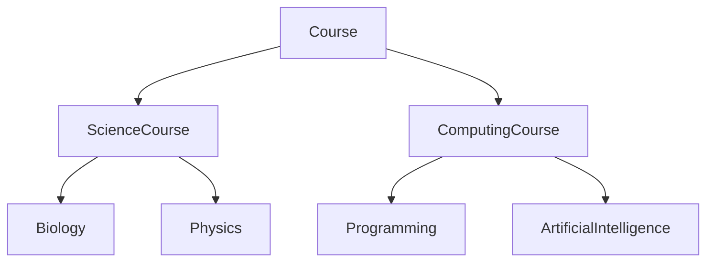

# Topic 17 — Diagrams and Pictures

Use these diagrams in the Markdown, study guide or slides. Mermaid diagrams render in GitHub when the fenced code block is preserved.

## Figure 1. From facts to a usable knowledge representation

**Caption:** A system first identifies what the information describes, then stores it in a form suitable for the task.

## Figure 2. A small knowledge graph

**Caption:** Nodes represent entities. Labelled arrows represent relationships. The same entities can appear in more than one triple.

## Figure 3. A simple class hierarchy

**Caption:** A taxonomy places specific categories under more general categories. Inheritance can pass general properties to more specific classes.

## Optional images to add

- A labelled example of a knowledge graph.
- A simple truth table for AND, OR and NOT.
- A frame represented as a card with slots and values.

Prefer diagrams made by the team using Mermaid, diagrams.net or Excalidraw. For external images, check the licence on the individual file page, record the creator and source, and include the required attribution. Wikimedia Commons is a useful place to search, but not every file has the same licence: https://commons.wikimedia.org/.
