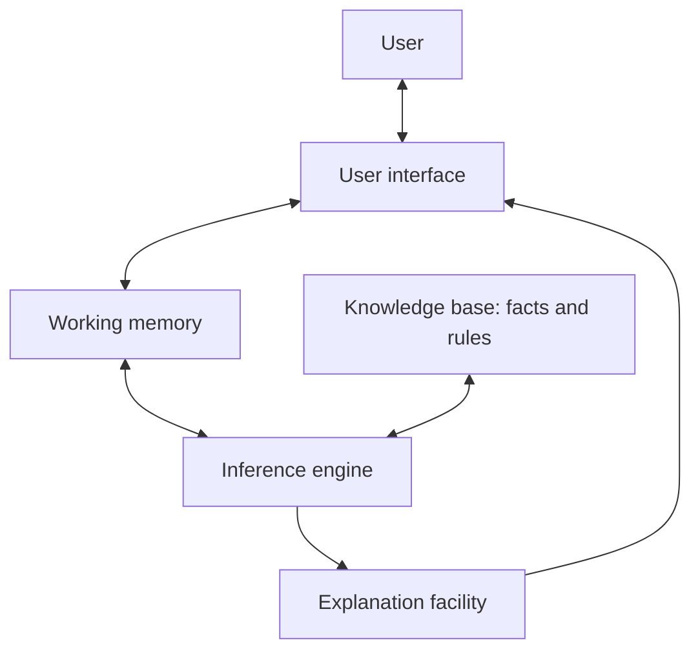
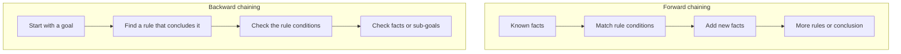
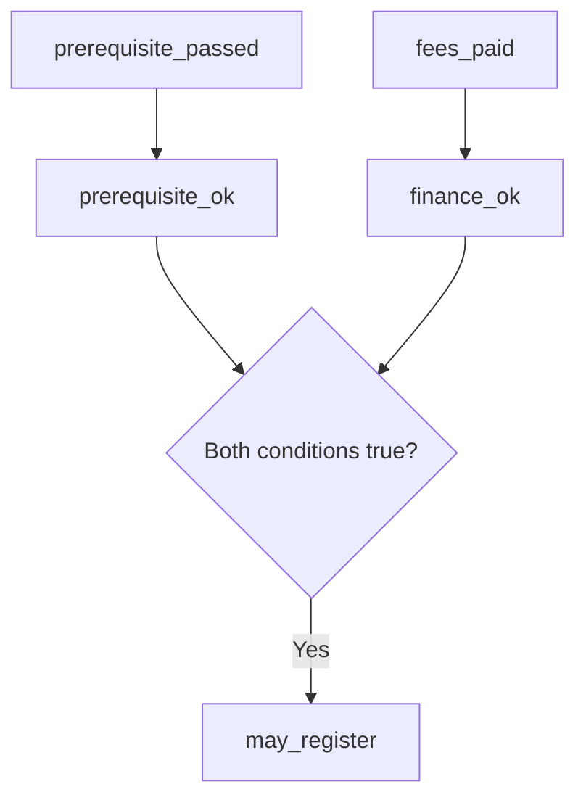

# Topic 18 — Diagrams and Pictures

## Figure 1. Basic expert-system architecture

**Caption:** The interface collects case information. The inference engine uses the knowledge base and current working memory to derive a result. An explanation facility can show which rules were used.

## Figure 2. Forward and backward chaining

**Caption:** Forward chaining moves from available facts towards conclusions. Backward chaining starts from a question and checks what would support it.

## Figure 3. Example rule trace

**Caption:** The conclusion is reached only after both conditions needed by the final rule have been established.

## Optional images to add

- A simplified historical MYCIN overview with a clear “historical example” caption.
- A small decision tree for technical troubleshooting.
- A table comparing deduction, induction and abduction.

Use team-made diagrams where possible. For external images, check the individual licence and attribution requirements before including them.
