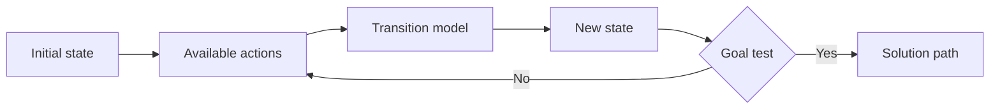
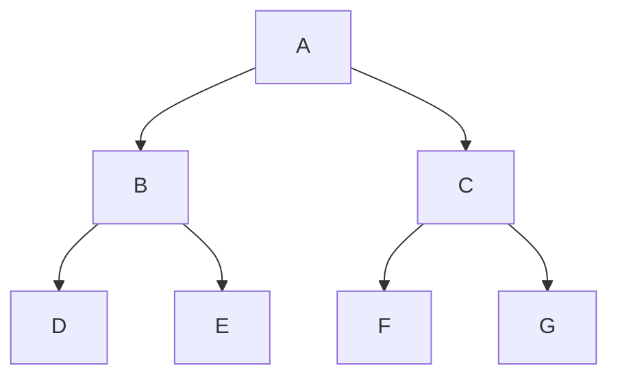
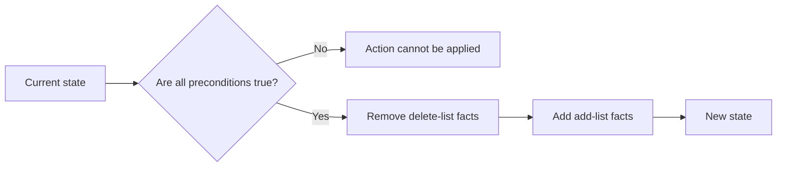

# Topic 19 — Diagrams and Pictures

## Figure 1. Search problem components



**Caption:** A search method explores possible actions and states until it finds a state that passes the goal test.

## Figure 2. BFS and DFS visit order



**Caption:** If children are considered left to right, BFS visits `A, B, C, D, E, F, G`. A depth-first traversal visits `A, B, D, E, C, F, G`.

## Figure 3. A* evaluation

```mermaid
flowchart TD
    A[Current node n] --> B[Calculate g(n): cost so far]
    A --> C[Estimate h(n): cost remaining]
    B --> D[f(n) = g(n) + h(n)]
    C --> D
    D --> E[Choose lowest f value on frontier]
```

**Caption:** A* combines the path cost already paid with an estimate of the cost still to come.

## Figure 4. STRIPS action



**Caption:** An action changes a state only when all its preconditions are satisfied.

## Optional pictures

- A simple maze with a marked start and goal.
- A route map with edge costs.
- A block-world picture showing a robot picking up a block.
- A small timetable grid showing a valid schedule.

The diagrams above can be used directly in GitHub. If exporting them as pictures for slides, keep the labels readable and add the caption. Check image licences and credits for any external photos or illustrations.
